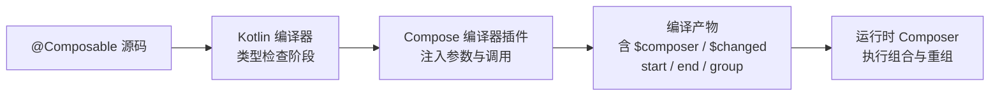
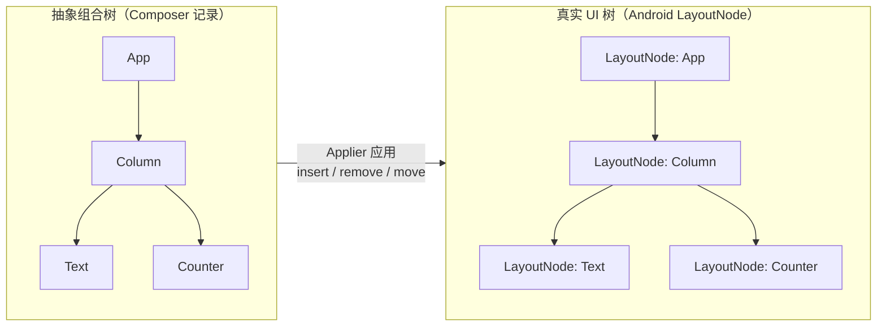
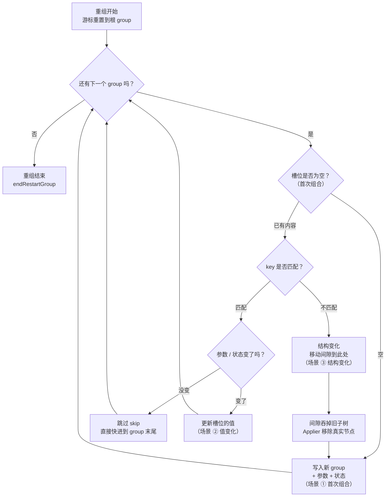
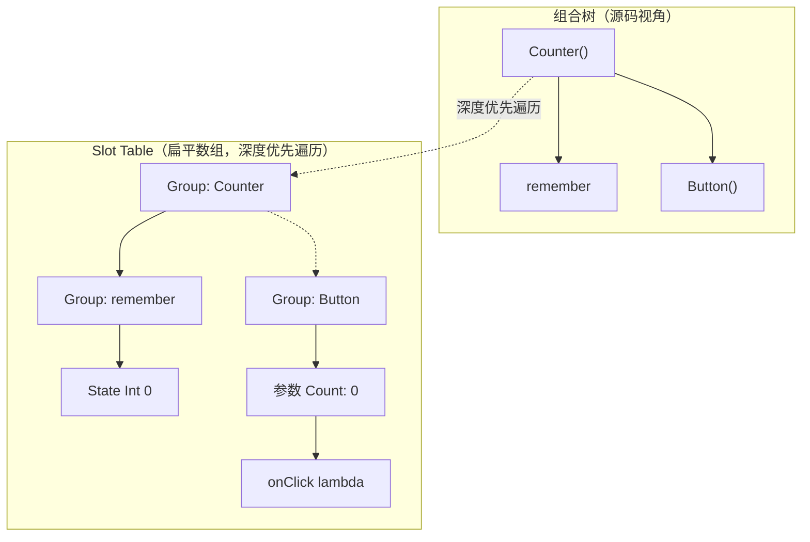
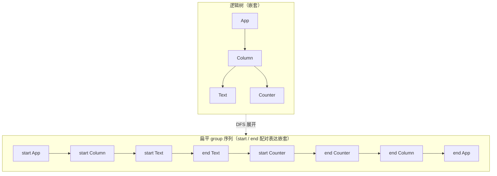
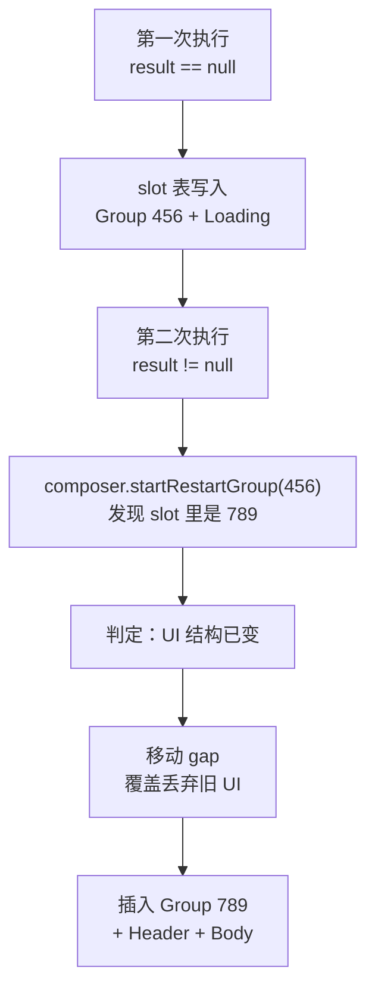
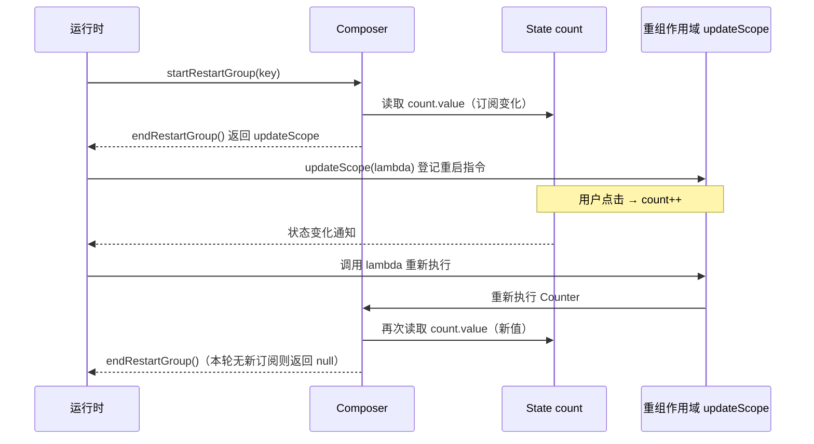
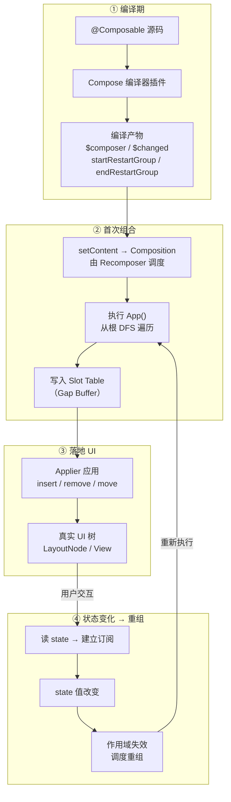

# Jetpack Compose 原理深度解析：跟随 `@Composable` 的编译之旅

> 本文基于 Leland Richardson 的《Under the hood of Jetpack Compose — part 2 of 2》整理与扩展，是姊妹篇中的"后篇"。
>
> 前篇（`jetpack-compose-mental-model.md`）讲的是**心智模型与 API 设计**；本篇讲**实现原理**。
>
> 本篇的组织方式与前篇不同：我们**不以"概念清单"来罗列**，而是跟随一次编译——**编译器看到 `@Composable` 之后到底做了什么？** 每一个概念，都从"编译产物长这样"倒推"为什么需要它"。这样你能真正理解每个概念的**由来**，而不只是它的定义。

## 0. 起点：一次编译前后对照

先看一个最简单的例子，然后观察编译器对它做了什么手脚。这是**我们写的代码**：

```kotlin
@Composable
fun Counter() {
    var count by remember { mutableStateOf(0) }
    Button(
        text = "Count: $count",
        onClick = { count++ }
    )
}
```

编译器处理过后，**概念上**会变成类似这样的东西（这是理解全文的地图，后面逐一拆解）：

```kotlin
fun Counter($composer: Composer?, $changed: Int) {
    $composer.startRestartGroup(/* 编译期生成的 key */)

    // var count by remember { mutableStateOf(0) }
    var count = $composer.remember { mutableStateOf(0) }

    // Button(...)
    Button("Count: $count", { count++ }, $composer, /* changed bits */)

    $composer.endRestartGroup()?.updateScope { /* 如何重启 Counter 的 lambda */ }
}
```

> **关于这段"编译产物"的准确性说明**（其余各处同理）：这是**概念性示意**，不是逐字节的真实产物。它与真实实现的几点差异，都已在后文标注：
> 1. `$composer` 的真实类型是 **`Composer?`（可空）**——因为组合树的根（root composition）没有 Composer，传入的是 `null`。（示意图为简洁省略了 `?.` 空安全调用。）
> 2. 注入的合成参数**不止两个**：`$composer` 是必须的；`$changed` 是一个或多个 `Int` 位掩码（参数很多时会拆成多个）；若函数有默认参数，还会注入 `$default: Int`。
> 3. 方法名在现代 Compose 里是 `startRestartGroup` / `endRestartGroup`（2020 年的早期版本叫 `start` / `end`）。

一眼看过去，编译器做了**五件事**：

1. 给函数**追加了合成参数**：`$composer`（可空的 `Composer?`）和 `$changed`（位掩码；有默认参数时还有 `$default`）；
2. 在函数体**开头**插入了 `$composer.startRestartGroup(key)`；
3. 把 `remember`、嵌套的 Composable 调用，都**转交给 `$composer`**；
4. 在函数体**结尾**插入了 `$composer.endRestartGroup()`；
5. `endRestartGroup()` 返回了一个**可空的东西**，上面有个 `updateScope` 方法。

下面我们就沿着这五件事，逐一倒推：**它们分别是为了解决什么问题？**

---

## 1. 为什么签名里多了 `$composer`？—— `@Composable` 的本质

### 1.1 它不是注解处理器，而是编译器插件

关于 `@Composable`，有一个最关键、也最容易被误解的事实：

> **Compose 不是一个注解处理器（Annotation Processor）。**

Compose 依赖的是一个 **Kotlin 编译器插件（Compiler Plugin）**，它在 Kotlin 的**类型检查阶段**和**代码生成阶段**介入，对代码进行改造。使用 Compose **完全不需要**注解处理器。

因此，`@Composable` 在语义上**更像一个语言关键字，而不是普通注解**。一个绝佳的类比是 Kotlin 的 `suspend` 关键字。

### 1.2 类比 `suspend`：它改变了函数类型

我们看 `suspend` 是怎么工作的：

- 它可以作用于**函数类型**：`suspend` 的函数声明、`suspend` 的 lambda、`suspend` 的函数类型。
- 它**改变了函数的类型**：`suspend (Int) -> String` 和 `(Int) -> String` 是**不兼容的**两种类型。
- 它**需要调用上下文**：你只能在另一个 `suspend` 函数里调用 `suspend` 函数。

`@Composable` **完全一样**：

```kotlin
val normal: (Int) -> String                    // 普通函数类型
val composable: @Composable (Int) -> String    // 这是"不同类型"的函数

// 两者互不兼容，不能互相赋值
```

当你用 `@Composable` 注解一个函数类型时，**你改变了这个函数的类型**。而 Composable 函数也需要**调用上下文**——你只能在另一个 Composable 函数里调用 Composable 函数。

**为什么需要调用上下文？** 答案就在第 0 节的编译产物里：因为编译器要往每个 Composable 函数里塞一个 `$composer` 参数，而这个参数**必须被贯穿传递**到所有嵌套的 Composable 调用中。这个"调用上下文对象"，就是 **Composer**。

### 1.3 编译器处理流程总览



---

## 2. `start/end` 之间数据存哪？—— Composer 与 Gap Buffer

编译器在函数体开头和结尾插入了 `start` 和 `end`。那么，`start` 和 `end` **之间**产生的那些数据（state、参数、嵌套调用……）被存到哪里去了？

答案是：**存进了 Composer 内部的一个数据结构**，这个数据结构与文本编辑器常用的 **Gap Buffer（间隙缓冲区）** 密切相关。

### 2.1 Gap Buffer 是什么？

Gap Buffer 是一种表示"带当前游标位置的集合"的数据结构：

- 在内存中用**一个扁平的数组**存储数据；
- 这个数组**比它实际要表示的数据更大**，多出来的未使用空间就是"**间隙（gap）**"。

```
初始状态（数组比实际数据大，留有空隙；_ 是空隙，| 是游标）：
[A][B][C][_][_][_]
          ↑
       游标/gap
```

一个正在执行的 Composable 层级，可以向这个结构中**插入内容**：

```
[A][B][C][D][E][_]
                ↑
```

当我们要**重组**某个部分时，把游标**重置到数组顶部**，重新执行一遍。执行中遇到已有的数据：**要么什么都不做，要么更新它的值**。如果 UI 结构变了、需要插入新内容，就把**间隙移动到当前游标位置**，然后插入：

```
把 gap 移动到当前游标位置：
[A][B][_][_][_][C][D][E]
       ↑

插入新内容：
[A][B][X][Y][_][C][D][E]
```

### 2.2 为什么选 Gap Buffer？

这个数据结构最重要的特性是：

> **除了"移动间隙"是 O(n) 之外，其余操作——get / move / insert / delete——都是常数时间 O(1)。**

选择它的理由是一个**赌注**：

- **平均而言，UI 的结构变化并不多。**
- 动态 UI 变化的往往是**值**，而不是**结构**。
- 即便结构真的变了，通常也是**一大块一大块地变**，所以做一次 O(n) 的间隙移动是**合理的权衡**。

这个赌注，是 Compose 整个性能模型的地基。

---

## 3. 从一棵树开始：Composer 到底在管理什么？

前面 §2 讲了 Composer 内部是"带间隙的扁平数组"。在深入 §4 的 slot table 细节之前，我们先退一步，从**一棵树**的角度建立感性认知——这是理解 Compose 原理最好用的心智图像。

### 3.1 先纠正一个常见的误解：Composer 不是"树"

一个很自然的理解是："Composer 就是一个贯穿 UI 元素树的数据结构。" 这个说法**方向对，但需要精确化**：

- UI 在**逻辑上**确实是一棵树（元素树）；
- 但这棵树**不是**用"指针链接的树节点"来存储的；
- 它被**扁平化**成一个带间隙的数组（就是 §2 的 Slot Table），排列顺序是**深度优先遍历（DFS）**；
- **Composer 不是树本身，而是驱动这个扁平数组的对象**——它负责 `startRestartGroup` / `endRestartGroup`、读写槽位、移动间隙。

一个贴切的比喻：**Composer 像一台录音机的读写磁头，而"树"是磁带上录下的内容**（按 DFS 顺序）。磁头（Composer）来回移动、读写、覆盖；磁带（Slot Table）上编码的，才是那棵树。

所以更准确的说法是：

> **Composer 是一个"把逻辑上的树，以 DFS 顺序扁平化地读写进 Slot Table"的驱动器。**

### 3.2 树的根在哪里？

这是建立全局观的关键。这棵树的"根"有三个层次，从外到内：

1. **代码入口**：`setContent { App() }` —— 你写的第一个 Composable 函数（`App`）就是这棵组合树的**逻辑根**。

2. **运行时对象**：`setContent` 内部会创建一个 **`Composition`** 对象（由 **`Recomposer`** 负责调度重组），它持有：
   - 一个**根 `SlotTable`**（那棵树的物理存储）；
   - 一个 **`Applier`**（见下）。

3. **SlotTable 里的根**：`App()` 的 group 就是 slot table 里的**第一组槽位**（根 group）。整棵树的全部内容，都从这个根 group 开始，按 DFS 顺序铺开。

> **关于 Applier**：Composer 记录的是一棵"抽象的组合树"（节点之间只有父子关系、没有具体 UI 语义）。`Applier` 负责把这棵抽象树"应用"到真实世界——在 Android 上就是把抽象节点映射成真实的 `LayoutNode` / View 树。树的结构变化（插入、删除、移动节点）最终都通过 Applier 反映到真实 UI。**一句话：Composer 管"描述"，Applier 管"落地"。**

用一张图看 Applier 的"桥梁"作用——左边是 Composer 记录的抽象树，右边是 Android 真实的节点树，中间靠 Applier 同步：



> 结构变化发生时，Composer 先把抽象树改好（移动间隙、插入/删除 group），再**通过 Applier 把同样的改动"重放"到真实 UI 树上**。这就是为什么 Compose 能脱离具体 UI 平台——换个 Applier，同一套组合树就能渲染到 View、桌面、甚至测试的模拟树。

### 3.3 一棵贯穿全文的示例树

下面这棵小树，会贯穿本节后续的所有演示：

```kotlin
setContent {
    App()                // ← 根
}

@Composable
fun App() {
    Column {             // 容器
        Text("标题")      // 叶子
        Counter()        // 计数器
        if (showList) {  // 条件分支
            ItemList(items)
        }
    }
}
```

它对应的**逻辑树**长这样：

```
App (根)
└── Column
    ├── Text("标题")
    ├── Counter
    └── ItemList          ← showList == true 时才有
```

### 3.4 这棵树如何被"扁平化"进 Slot Table

Compose 执行 `App()` 时，从根开始做**深度优先遍历**，把每个节点按顺序写进 Slot Table（`▢` 表示还没用到的间隙空间）：

```
树的 DFS 顺序：  App → Column → Text → Counter → ItemList
                        ↓
Slot Table:  [App][Column][Text][Counter][ItemList][▢][▢][▢]
              ↑ 根 group                                  ↑ 间隙
```

展开到 group 与 slot 的粒度（每个 Composable 是一个 group，group 里存它的参数/状态）：

```
[0] Group: App
[1]   Group: Column
[2]     Group: Text     → 存参数 "标题"
[3]     Group: Counter  → 存状态 count
[4]     Group: ItemList → 存参数 items        (showList == true)
```

> 关键：**树在逻辑上是"嵌套"的，在 Slot Table 里是"平铺"的**——父子关系不靠指针，而靠"谁在谁的 start/end 之间"这个位置关系来表达（§4 会讲 group 如何维护这种嵌套）。

### 3.5 基于这棵树，看每一步的变化

现在，用这棵树把 Compose 的三种核心操作走一遍，建立感性认知：

#### ① 首次组合（初始渲染）

从根开始 DFS，依次写入 `[0]→[1]→[2]→[3]→[4]`，同时 Applier 把这 5 个抽象节点"应用"到真实 UI 树：

```
Slot Table:  [App][Column][Text][Counter][ItemList][▢][▢][▢]
真实 UI:      App
              └── Column
                   ├── Text
                   ├── Counter
                   └── ItemList
```

#### ② 值变化（重组，结构不变）

用户点了 `Counter` 的按钮，`count` 变了。Compose 把游标**重置到根 `[0]`**，重新 DFS 一遍：

```
[0] App      → 没变，跳过
[1] Column   → 没变，跳过
[2] Text     → "标题"没变，跳过
[3] Counter  → count 变了 → 更新这个槽位的值 ✓
[4] ItemList → 没变，跳过
```

**结构完全没动，只更新了 `[3]` 一个值**——这就是 Compose 高效重组的本质：树不变，只改叶子上的值。

#### ③ 结构变化（showList 从 true → false）

这次 `showList` 变成了 `false`。DFS 走到 if 分支时，运行时（Composer）发现 slot table 里 `[4]` 的 group key 与现在的分支不匹配，于是：

1. 把**间隙移动到 `[4]`**，用间隙"吞掉" `[4] ItemList` 这整棵子树；
2. Applier 收到通知，把真实 UI 树里的 `ItemList` 节点**移除**；

```
Slot Table:  [App][Column][Text][Counter][▢][▢][▢][▢]
                                            ↑ 间隙吞掉了 ItemList
真实 UI:      App
              └── Column
                   ├── Text
                   └── Counter              (ItemList 没了)
```

3. 如果 `showList` 又变回 `true`，就在间隙处重新插入 `ItemList`——Applier 再把它加回真实 UI。

#### ④ 把三种变化合成一张决策图

上面三个场景看似不同，其实是**同一个算法**。这张流程图把"Compose 重组时，游标从根一路扫下来、遇到每个 group 做了什么判断"完整画了出来（`①②③` 分别对应上面的三个场景）：



逐条路径读这张图：

- **槽位为空** → 场景①：第一次组合，直接写入新 group；
- **槽位有内容、key 不匹配** → 场景③：这是"结构变了"的**唯一信号**——移动间隙吞掉旧子树、Applier 移除真实节点，然后当新内容插入；
- **槽位有内容、key 匹配** → 再看"值变没变"：没变就**跳过（skip）**（对应场景②里那些"没变，跳过"的行），变了就**更新值**（对应场景②里 Counter 那一行）。

> 注意：这张图里的"**跳过（skip）**"是 Compose 最重要的优化之一——`$changed` 位掩码（§6）就是用来在"值变没变"这一步做**快速判断**，从而避免逐个 `equals` 比较。§5 会详细展开位置记忆化，§6 展开 skip 与 `$changed`。

---

到这里，你应该有了一个感性的画面：**Compose 的每一次"重画"，本质都是在"一棵逻辑树 → 一条扁平数组"的映射上，用最小改动（改值 / 移动间隙）去同步真实 UI。** 下面 §4 开始，我们就进入这条扁平数组（Slot Table）的内部细节。

---

## 4. `start/end` 之间到底写了什么？—— Slot Table 与 Group

### 4.1 执行时发生了什么

回到 Counter 的例子。当编译产物被执行时，Composer 依次做了这些事：

1. `Composer.startRestartGroup(key)` 被调用，**存储了一个 group 对象**；
2. `remember` 插入一个 group 对象；
3. `mutableStateOf` 返回的**状态实例（state instance）** 被存储下来；
4. `Button` 存储一个 group，接着是它的**每一个参数**；
5. 最后到达 `composer.endRestartGroup`。

执行完毕后，这个数据结构（我们称之为 **Slot Table，槽位表**）里就装满了整个组合（Composition）的所有对象——**整棵树以执行顺序排列**，实际上就是对这棵树的**深度优先遍历**：



> 这张图里的箭头只是"顺序"。更本质的问题是：**扁平的数组，怎么表达"谁是谁的父节点"？** 答案是靠 `startRestartGroup` / `endRestartGroup` 的**配对**——父 group 的 start 和 end 之间，夹着它所有子 group 的 start/end。看下面这张图，左边的嵌套树，被展开成右边一段 start/end 配对的扁平序列，父子关系就靠这种"夹在中间"来表达：



> 这正是"树 ↔ 扁平数组"双向映射的精髓：**递归的嵌套结构，靠 start/end 的配对括号被线性化；重组时游标从头扫到尾，靠配对括号就能还原出树的层级。**（这跟 Lisp 的括号、HTML 的标签是同一回事。）

### 4.2 Group 对象是干什么的？

你会发现这些 group 对象占据了大量空间。它们的作用是：

> **管理"动态 UI 可能发生的移动和插入"。**

编译器**知道**哪些代码会改变 UI 结构，所以它会**有条件地插入 group**。大多数时候不需要它们，所以不会往 slot table 里塞太多 group。

用条件逻辑说明：

```kotlin
@Composable
fun App() {
    val result = getData()
    if (result == null) {
        Loading(...)
    } else {
        Header(...)
        Body(...)
    }
}
```

编译器会**为 if 语句的每个分支插入独立的 key**：

```
App (key: 123)
  ├── Group (key: 456)   ← "result == null" 分支
  │     └── Loading
  └── Group (key: 789)   ← "else" 分支
        ├── Header
        └── Body
```

现在看这个结构的妙处——**它让运行时能"免费"地检测结构变化**（编译器只需在编译期插好 group 和 key）：



1. 第二次执行走到 `composer.startRestartGroup(456)`，但发现 slot table 里对应位置是 key **789**，不匹配 → **立刻知道 UI 结构变了**。
2. Composer 把**间隙移动到当前游标位置**，让间隙**跨越原来的 UI**，等于把它丢弃。
3. 代码正常执行，新的 UI（Header + Body）被插入。

这个 if 语句的开销，仅仅是 slot table 中的**一个 slot 条目**。通过这一个 group，UI 就有了**任意控制流**，运行时得以在执行 UI 的同时管理它，并利用这个类缓存的数据结构。

### 4.3 这个概念的正式名称

这个核心概念，我们称之为：

> **位置记忆化（Positional Memoization）**

这是 Compose **从底层开始就围绕它构建**的概念。

---

## 5. 为什么能"跳过"没变的部分？—— 位置记忆化

### 5.1 全局记忆化 vs 位置记忆化

通常的"记忆化"是**全局的**：根据**函数输入**缓存输出，输入相同就返回缓存结果。

而**位置记忆化**完全不同：它根据**函数在组合树中的位置**来记忆。

```kotlin
@Composable
fun App(items: List<String>, query: String) {
    val results = remember(items, query) {
        items.filter { it.matches(query) }
    }
    // 使用 results 渲染
}
```

1. `remember` 知道如何利用 slot table：它把 `items` 和 `query` 存进 slot table；
2. 过滤计算执行，`remember` 在返回前把结果也存起来；
3. **第二次执行时**，`remember` 拿新值和旧值比较——**如果都没变，就跳过过滤，直接返回旧结果**。

这就是**位置记忆化**。

### 5.2 为什么它如此便宜

这个操作的成本**极低**：运行时只需**存储一次之前的调用结果**。这种计算遍布整个 UI，但因为**按位置存储**，它只为**那个位置**存一份——内存开销是线性且可预测的。

### 5.3 零输入退化：持久性 = 状态

`remember` 的签名大致是（接收任意数量的输入，外加一个计算函数）：

```kotlin
@Composable
fun <T> remember(vararg inputs: Any?, calculation: () -> T): T
```

有意思的是**零输入**的退化情形：

```kotlin
@Composable
fun App() {
    val x = remember { Math.random() }
    // 每次 App 出现，x 是新的随机数
    // 但每次 App 重组，x 保持同一个值
}
```

我们**故意滥用**这个 API，记忆一个**刻意不纯**的计算 `Math.random()`：

- 用**全局记忆化**，这毫无意义——空输入永远相同，结果永远缓存同一个值。
- 但用**位置记忆化**，它产生了**全新的语义**：
  - **每次在组合层级中使用 `App`**，返回一个新的 `Math.random()` 值；
  - 但**每次这个 Composable 重组**，返回相同的 `Math.random()` 值。

这种"跨重组保持不变"的特性，就是**持久性（Persistence）**，而持久性正是**状态（State）** 的源头。

> **状态 = 位置记忆化在零输入情形下的持久性。** 这是理解 Compose 状态模型的一把钥匙。

### 5.4 remember 的内部机制：编译后它变成了什么

前面讲的是"位置记忆化"这个抽象概念。现在把 `remember` 放回我们贯穿全文的"编译主线"里，看它**编译后变成了什么、运行时怎么工作**。

> 这一节对应前篇（`jetpack-compose-mental-model.md`）§6「状态与 remember」——那里讲"怎么想、怎么用"，这里讲"它编译后到底是什么"。

#### 编译后：remember 被转交给 Composer

我们写的：

```kotlin
@Composable
fun App(items: List<String>, query: String) {
    val results = remember(items, query) {
        items.filter { it.matches(query) }
    }
}
```

编译器会把 `remember` 的调用**改写成一个对 Composer 的调用**（概念性示意）：

```kotlin
fun App(items: List<String>, query: String, $composer: Composer?, $changed: Int) {
    $composer.startRestartGroup(/* App 的 key */)

    // remember(items, query) { ... } 被改写成：
    val results = $composer.cache(
        invalid = /* 由 $changed 的位判断 items / query 是否变了 */,
        block = { items.filter { it.matches(query) } }
    )

    $composer.endRestartGroup()
}
```

关键点：**`remember` 不是什么"魔法"——它就是一次对 Composer 上 slot table 的"按位置读写"。** 编译器负责生成"比较 key 是否变化"的逻辑（那个 bit 运算，即 §6 要讲的 `$changed` 位掩码），而 Composer 负责"记住上次的值、决定返回旧的还是执行新的"。

#### 一个简化的内部实现

Composer 内部（极度简化的伪代码）大概是这样的：

```kotlin
fun <T> cache(invalid: Boolean, block: () -> T): T {
    // 1. 找到"当前调用点"对应的槽位（位置由执行顺序天然决定）
    val slot = slotTable.current()

    if (invalid || !slot.hasValue()) {
        // 2. key 变了（或第一次执行）：执行计算，写入槽位
        val value = block()
        slot.write(value)
        return value
    } else {
        // 3. key 没变：直接返回槽位里存的上一次的值
        return slot.read<T>()
    }
}
```

这就是 `remember` 的全部"魔法"：**一个按当前位置读写的小缓存**。它之所以快，是因为"找位置"这件事由执行顺序（深度优先遍历）天然决定，**不需要哈希、不需要 key 匹配查找——位置本身就是索引。**

#### key 的比较：`equals` 而非引用

`remember(items, query)` 比较 key 时，用的是 `equals`（结构性相等），不是引用相等。这就是为什么：

- `remember(listOf("a"))` 两次传入内容相同的 `List`，会被视为"key 没变"；
- 但如果 key 是自定义类、且没正确实现 `equals`，就可能导致"以为变了其实没变"（或相反）的 bug。

#### 遗忘（forget）：位置消失时

当 remember 所在的 Composable **离开组合**（if 分支不成立、列表项被移除），它在 slot table 里的槽位会被**丢弃**——这就是"遗忘"。remember 记住的值**跟着位置一起生灭**，这是它和全局缓存最本质的区别，也是它内存可控的根源。

#### rememberSaveable：额外走一层 Saver + SaveableStateRegistry

`rememberSaveable` 在 `remember` 的基础上，多走了一层"**可保存**"机制：

1. 它仍然用 `remember` 把值存在 slot table 里（保证跨重组存活）；
2. 此外，它把值**注册到 `SaveableStateRegistry`**，并借助 **`Saver`** 把值转成 `Bundle` 能接受的类型；
3. 当 Activity 因配置变更或进程重建时，`SaveableStateRegistry` 把值序列化进 `Bundle`，重建后从 `Bundle` 恢复。

所以 `rememberSaveable` = `remember`（跨重组）+ `Saver`（跨进程/配置存活）。它支持 `Bundle` 可序列化的类型，复杂类型需要自定义 `Saver`。

#### rememberUpdatedState：一行代码看透它

`rememberUpdatedState` 是 remember 家族里**实现最短、却最能体现"位置记忆化"本质**的一个。它的官方实现（简化）只有一行：

```kotlin
@Composable
fun <T> rememberUpdatedState(newValue: T): State<T> =
    remember { mutableStateOf(newValue) }.apply { value = newValue }
```

拆开看，这行代码由两个各司其职的部分组成：

1. **`remember { mutableStateOf(newValue) }`** —— 这是"**位置记忆化**"：`mutableStateOf` 创建的 State 对象，只在**第一次组合**时被创建并写入 slot table；之后每次重组，`remember` 都从同一个槽位返回**同一个 State 对象**。这就是为什么 `rememberUpdatedState` 返回的 State **引用永远稳定**。

2. **`.apply { value = newValue }`** —— 这是"**每次写新值**"：每次重组，`apply` 都会执行，把最新的 `newValue` 写进 State 的 `.value`。

合起来就是：

> **一个"引用永远不变、但 value 每次重组都更新"的 State。**

对照前篇 §6.5 ⑥ 的心智模型——"把'值'换成'引用'"——这里就是它的**底层真相**：闭包捕获的是那个**稳定的 State 引用**，读 `.value` 时拿到的是**每次写进去的最新值**。

**它和普通 `remember` 的关键区别**：

| | 普通 `remember` | `rememberUpdatedState` |
|---|---|---|
| 槽位里存什么 | 第一次计算的结果 | 一个 State 对象（本身不变） |
| 每次重组做什么 | key 没变 → 直接返回旧结果 | 无论 key 变不变，都 `apply { value = newValue }` 写新值 |
| 返回值的"引用" | 可能变（key 变了就换新对象） | 永远稳定 |

换句话说，`rememberUpdatedState` **故意"放弃"了 `remember` 的"跳过"能力**——它不要"记住并复用旧值"，它要的是"记住一个容器，然后每次往容器里灌新值"。它要的不是值本身稳定，而是**容器（State 引用）稳定**。

**为什么写 `.value = newValue` 不会导致副作用重启？**

因为读这个 State 的地方，是 `LaunchedEffect(Unit)` 之类的副作用，而**副作用的 key 是 `Unit`（不变）**，所以它不会因为 State 的 value 变化而重启——它只是每次"读取时"拿到最新的 value。`rememberUpdatedState` 真正避免的，是"把 `onTimeout` 直接放进 effect 的 key"所导致的重启（前篇 §6.5 ⑥ 已对比过三种写法）。

这也串回了本节的编译主线：**`rememberUpdatedState` 底层就是一个 `remember` + 一个"每次写入"的 `mutableStateOf`**——没有引入任何新的运行时机制，完全由我们已经讲过的"位置记忆化"和"可观察状态"两个零件拼装而成。

> 至此，remember 家族三兄弟的底层拼装关系就清晰了：
> - `remember` = 位置记忆化（按位置存/取，key 变了重算）；
> - `rememberSaveable` = `remember` + `Saver` / `SaveableStateRegistry`（跨进程存活）；
> - `rememberUpdatedState` = `remember` + 每次写新值的 `mutableStateOf`（引用稳定、值最新）。

---

## 6. 参数为什么要存？—— 参数存储与 static 优化

编译器往 Composable 调用里传的 `$changed` 参数（第 0 节里的那个 `$changed`），现在派上用场了。

### 6.1 参数如何存进 slot table

Compose 把 Composable 函数的参数存进 slot table。看这个例子：

```kotlin
@Composable
fun Google(number: Int) {
    Address(
        number = number,
        street = "Mountain View",
        state = "CA",
        zip = "94043"
    )
}

@Composable
fun Address(number: Int, street: String, state: String, zip: String) {
    Text("$number $street")
    Text("$state $zip")
}
```

如果所有参数都要存，这里会有**冗余**：`"Mountain View"` 和 `"CA"` 在 `Address` 调用里加一次，又在底层 `Text` 里再存一次——**存了两遍**。

### 6.2 那个位掩码参数：`$changed`

编译器给 Composable 函数追加的 `$changed` 参数，是一个**位掩码（bitmask）**，用来记录"每个参数自上次组合以来是否发生了变化"，好让运行时**决定要不要跳过某个参数的存储与比较**：

> 如果编译器能确定某个参数"没变"，就不需要为它做任何事。

在 Google 例子中，编译器在 `$changed` 里编码出 street / state / zip 都不会变，只有 `number` 需要关注。然后在 `Address` 内部，编译器做同样的事，把信息继续传给 `Text`。

```kotlin
// 编译器改造后的伪代码（示意）
fun Google(number: Int, $composer: Composer?, $changed: Int) {
    // $changed 的某些位编码了 street/state/zip "确定不变"
    Address(number, "Mountain View", "CA", "94043", $composer, /* 传播的 changed bits */)
}
```

> 补充一个精确的细节：`$changed` **不是"每个参数一个 bit"**。真实实现里，每个参数占用约 **3 个 bit**——其中 1 个 bit 记录"类型是否稳定"，另外 2 个 bit 编码三种变化状态：`Same`（确定相同）、`Different`（确定不同）、`Uncertain`（不确定，需 `equals` 比较）。此外 `$changed` 整数的最低 bit 是一个"强制重组"标志；参数很多时 `$changed` 还会拆成多个 `Int`。

这种位运算很难读——**但我们不需要理解它：编译器擅长这个，人类不擅长。**

### 6.3 进一步优化：常量与"快进"

在这个例子里，不仅有冗余信息，还有**常量**。结果证明，**常量也不需要存储**。

于是整个层级结构完全由 `number` 一个参数决定——**这是运行时唯一需要存进 slot table 的值**。

基于此，编译器可以走得更远：生成代码让它理解"`number` 是唯一会变的东西"。这样，**如果 `number` 没变，就完全跳过函数体**，并指示 Composer 把索引**直接快进**到函数体执行完毕的位置：

> Composer 知道该快进多远，才能恢复到它需要继续执行的位置。

这也是 Compose "跳过（skip）"机制如此高效的原因：参数没变时，重组几乎零成本地掠过整段代码。

---

## 7. `endRestartGroup()` 返回的那个东西？—— 重组与 updateScope

### 7.1 重组是怎么被"触发"的

回到 Counter。编译器生成的代码包含 `start` 和 `end`。关键机制如下：

1. 每当 `Counter` 执行时，运行时明白：当它调用 `count.value`（读取 `count` 属性）时，是在**读取一个状态实例的属性**。
2. 运行时调用 `composer.endRestartGroup()` 时，**可以选择性地返回一个值**——这个值上有一个 `updateScope` 方法。
3. 我们对这个值调用 `updateScope`，传入一个 lambda，告诉运行时"**如果需要，如何重启这个 Composable**"：

```kotlin
// 概念示意：updateScope 接收一个"如何重新执行我"的 lambda
$composer.endRestartGroup()?.updateScope { nextComposer ->
    Counter(nextComposer)   // 重新执行整个 Counter 的指令
}
```

这个 lambda 等价于 `LiveData` 本来会收到的那个回调：**状态变化时，框架知道该"重新执行"哪一段代码。**

把"读状态 → 订阅 → 状态变化 → 触发重组"这条**因果链路**画出来，会更直观（它与 §7.3 的时序图互补：那张画"谁先谁后"，这张画"为什么"）：

```mermaid
flowchart LR
    A["Composable 执行\n读到 count.value"] --> B["运行时记录：\n这个重组作用域依赖了 count"]
    B --> C["用户点击 → count++\n（写入新值）"]
    C --> D["State 标记为\"脏\"\n通知所有依赖它的作用域"]
    D --> E["作用域失效\n被调度进入重组"]
    E --> F["重新执行 Composable\n读到新的 count.value"]
    F -->|"执行中又读到 state"| B
```

关键就一句话：**"读"就是"订阅"。** Composable 每次执行时读了哪个 state，运行时就把"这个作用域"登记为该 state 的依赖者；将来这个 state 一变，所有依赖它的作用域就被标记失效、重新执行。这也是为什么**没读任何 state 的 Composable 永远不会被重组**（见下）。

### 7.2 为什么 updateScope 是可空的？

注意那个 `?`——返回值是**可空的**。原因：

> **如果 `Counter` 执行期间没有读取任何状态对象，那就没必要教运行时"如何更新这段代码"，因为我们知道它永远都不会更新。**

这是非常漂亮的优化：Compose **只在真正依赖了状态的地方**才建立重组作用域。一个纯静态的 Composable 永远不需要重组，因此不产生任何重组开销。

### 7.3 一次完整重组的时序



---

## 8. 副作用（Effect）的底层：结构化并发与组合生命周期

> 前篇（`jetpack-compose-mental-model.md`）§7 讲了副作用的心智模型——什么是副作用、为什么 Composable 要纯、key 如何控制重启。这里讲它的**底层**：这些 effect API 在编译主线里到底是什么。

### 8.1 副作用 API 本身也是 Composable

一个容易被忽略的事实：`LaunchedEffect`、`DisposableEffect`、`SideEffect` **本身都是 `@Composable` 函数**。

这意味着：它们编译后，和 `Counter`、`Button` 一样，走 `start/end`、写 slot table、接收 `$composer` 参数。**副作用不是"独立于编译主线的另一套东西"——它就是我们前面讲过的所有机制的组合。**

所以"副作用怎么挂到组合生命周期上"这个问题的答案，就藏在它内部用了哪些我们已经讲过的零件里。

### 8.2 LaunchedEffect 的底层拆解

`LaunchedEffect(key1, key2) { block }` 的"概念性实现"大致是（**不是真实源码，但抓住了本质**）：

```kotlin
@Composable
fun LaunchedEffect(vararg keys: Any?, block: suspend CoroutineScope.() -> Unit) {
    // ① 记住一个绑定组合生命周期的协程作用域（位置记忆化）
    val scope = remember { rememberCoroutineScope() }

    // ② 记住上一次的 key（用于检测变化——和 remember 的 key 比较是同一套机制）
    val oldKeys = remember { keys.toList() }

    // ③ 记住协程 job
    val job = remember { scope.launch { block() } }

    // ④ key 变了 → 取消旧协程 + 启动新协程（这就是"重启"）
    if (oldKeys != keys.toList()) {
        job.cancel()                    // 取消旧协程（结构化并发）
        oldKeys = keys.toList()
        scope.launch { block() }        // 启动新协程（重启的第二步）
    }
}
```

拆开看，它用了三个我们已经讲过的零件：

1. **`remember { rememberCoroutineScope() }`** —— 位置记忆化：保证每次重组拿到**同一个**协程作用域。
2. **`remember { keys.toList() }` + 比较** —— 也是位置记忆化：检测 key 是否变化。**这和 `remember(items, query)` 检测 key 是同一套机制**（位置 + `equals` 比较）。
3. **`job.cancel()` + `scope.launch`** —— 这是 Kotlin 协程的**结构化并发**，负责"取消旧 + 启动新"。

### 8.3 "重启"的底层 = 结构化并发（Structured Concurrency）

前篇 §7.4 说的"重启 = 先取消旧协程、再启动新协程"，在底层就是 Kotlin 协程的**结构化并发**：

- 每个协程都挂在一个 `Job` 上；
- 取消一个 `Job`（`job.cancel()`）会**级联取消**它的所有子协程；
- 而 `rememberCoroutineScope()` 返回的作用域，是**绑定组合生命周期**的：当这个 Composable 离开组合时，这个 scope 会被自动取消，于是它启动的所有协程（effect）也被级联取消。

这就解释了前篇 §7.4 的三条规则在底层的对应：

| 前篇的规则（心智层面） | 底层的机制 |
|---|---|
| 第一次进入组合 → 启动副作用 | `scope.launch` 启动协程 |
| key 变化 → 重启（先取消再启动） | `job.cancel()` + 重新 `launch` |
| 离开组合 → 副作用结束 | scope 绑定组合，离开时被取消 → 级联取消子协程 |

### 8.4 DisposableEffect 的 onDispose：清理的底层

`DisposableEffect` 和 `LaunchedEffect` 类似，多了一个 `onDispose` 回调，用于**清理**：

```kotlin
DisposableEffect(key) {
    val listener = registerListener()   // 注册（副作用）
    onDispose {                         // 清理
        unregisterListener(listener)
    }
}
```

底层机制：`onDispose` 这个 lambda 被 `remember` 存起来，在**两个时机**被调用：

1. **key 变化**：先调用旧的 `onDispose`（清理旧资源），再执行新的副作用体；
2. **离开组合**：调用 `onDispose` 清理。

这就是"先清理再执行 / 离开时清理"的底层实现——本质上仍是"位置记忆化（存 onDispose）+ 在 key 变化或离开组合时触发"。

### 8.5 串回编译主线：副作用没有引入任何新机制

现在可以下结论了：

> **副作用（effect）在底层 = Composable + `remember`（存作用域/key/onDispose）+ 结构化并发（`Job.cancel` / `launch`）+ 组合生命周期（离开时取消）。**

它**没有引入任何新的运行时机制**，全部由我们前面讲过的零件拼装而成：

```
LaunchedEffect 是 @Composable
  → 编译后走 startRestartGroup/endRestartGroup、写 slot table（§4）
    → 内部用 remember 记住 scope 和 key（§5 位置记忆化）
      → key 变了就 job.cancel() + launch（结构化并发 = 重启）
        → 离开组合时 scope 被取消（组合生命周期 = 清理）
```

这正好呼应了前篇 §7 的结论——副作用之所以要"受控"，是因为它本质上是一个"用位置记忆化 + 协程"小心拼装出来的、绑定组合生命周期的机制。

---

## 9. 全貌：把一切串起来

### 9.1 编译产物的完整样子

把前面所有片段整合，一个简单 Composable 的完整编译产物大致是：

```kotlin
@Composable
fun Counter(count: Int, onIncrement: () -> Unit) {
    Text("Count: $count")
    Button("Increment", onClick = onIncrement)
}
```

编译器（概念性地）生成：

```kotlin
fun Counter(
    count: Int,
    onIncrement: () -> Unit,
    $composer: Composer?,
    $changed: Int                       // 位掩码：编码哪些参数"可能"变了
) {
    $composer.startRestartGroup(KEY_COUNTER)   // 等价于 start

    Text("Count: $count", $composer, /* changed bits for count */)
    Button("Increment", onIncrement, $composer, /* changed bits */)

    $composer.endRestartGroup()?.updateScope { nextComposer ->
        Counter(count, onIncrement, nextComposer, $changed)
    }
}
```

几个要点：

- **`startRestartGroup` / `endRestartGroup`**：标记一个"可重启作用域"，即重组的最小单元。
- **`$composer` 被贯穿传递**：所有嵌套调用收到同一个 Composer。
- **`endRestartGroup` 返回可空的 `updateScope`**：只有当作用域内读了状态时才非空。
- **`$changed` bitfield**：告诉下一层"哪些参数变了"，从而决定跳过还是重执行。

### 9.2 端到端全生命周期总览

这是全文最完整的一张图——把前面所有章节串成一条**闭环**，从"写代码"一路走到"屏幕上的 UI 被更新"，再回到"重新执行"。对照它回看全文，你会发现自己对 Compose 已经有了一个整体的、感性的认知：



四个阶段，正好对应全文的主线：

| 阶段 | 对应章节 | 一句话 |
|---|---|---|
| ① 编译期 | §1、§2 | `@Composable` 被编译器改写成带 `$composer`/`$changed` 的普通函数 |
| ② 首次组合 | §3、§4、§5 | `setContent` 创建 Composition，从根 DFS 把树写进 Slot Table |
| ③ 落地 UI | §3.2 | Applier 把抽象树同步到真实 UI 树 |
| ④ 状态变化 → 重组 | §6、§7、§8 | 读即订阅；state 一变，作用域失效，重新执行（回到②） |

> 注意那条**从 ④ 回到 ② 的箭头**——它是 Compose 的"心跳"：每一次用户交互、每一次状态变化，都走一遍"重新执行 → 更新 Slot Table → 同步 UI"的闭环。理解了这张图，就理解了 Compose 的整个引擎。

---

## 10. 核心概念速查表

| 概念 | 含义 | 关键点 | 由哪件"编译行为"引出 |
|---|---|---|---|
| **@Composable** | 类似语言关键字的注解，由编译器插件处理 | 改变函数类型；需要调用上下文 | 签名里多出 `$composer` |
| **Composer** | 贯穿所有调用的上下文对象 | 持有 Gap Buffer / Slot Table | 那个贯穿传递的 `$composer` 参数 |
| **Gap Buffer** | 带游标的扁平数组 | 除移动间隙 O(n)，其余 O(1) | `start/end` 之间数据的存放处 |
| **Slot Table** | 存储组合树所有对象的槽位表 | 按执行顺序 = 深度优先遍历 | `start/end` 之间写入了什么 |
| **Group** | 管理动态 UI 移动/插入的分组 | 由编译器有条件地插入 | `start(key)` 里的 key |
| **key** | 编译期生成的整型标识 | 用于在重组时识别结构变化 | 每个分支插入独立 key |
| **Positional Memoization** | 按"位置"而非"输入"记忆 | Compose 的根基 | 按位置存 → 能跳过没变的 |
| **remember** | 位置记忆化的 API | 零输入时退化为"持久性 = 状态" | `remember` 转交给 Composer |
| **`$changed` 位掩码** | 编码每个参数变化状态的位掩码 | 跳过存储与跳过执行 | `$changed` 参数 |
| **RecomposeScope / updateScope** | 重组的可重启作用域 | 仅读取了状态时非空 | `end()` 的可空返回值 |
| **副作用 / Effect** | 绑定组合生命周期的协程块（`LaunchedEffect` 等） | key 变 → `job.cancel`+`launch`；离开 → scope 取消 | effect 本身也是 `@Composable` |

---

## 11. 总结

最后，有几件事需要牢记：

1. **大部分细节只是实现细节。** Composable 函数相比普通 Kotlin 函数有**不同的行为和能力**。理解它们如何实现有时很有帮助，但请记住：**行为和能力不会变，但实现可能会变。**

2. **编译器在持续优化。** Compose 编译器能在特定场景生成更高效的代码，这些优化还会不断改进——所以你不该、也不需要把代码写得"迎合当前实现细节"。

3. **抓住不变的本质。** 本文真正想传达的核心，其实是一条线：

   ```
   @Composable 改变函数类型
     → 编译器注入 $composer 参数（调用上下文）
       → Composer 内部用 Gap Buffer 存储（增量更新的数据结构）
         → 按执行顺序写入 slot table（深度优先遍历 + group/key）
           → 按位置记忆（位置记忆化 → remember → 状态）
             → end() 返回 updateScope（重组的最小作用域）
               → 副作用（Effect）= 上述零件 + 结构化并发（§8）
   ```

   理解了这条"编译之旅"，你就真正理解了 Jetpack Compose 的引擎是如何运转的。副作用不是这条主线之外的例外，它本身就是这条主线上的一个"应用"。

---

## 参考

- Leland Richardson, *Understanding Jetpack Compose — part 1 of 2*, Android Developers on Medium, 2020.（前篇，心智模型）
- Leland Richardson, *Under the hood of Jetpack Compose — part 2 of 2*, Android Developers on Medium, 2020-08-28.（本篇蓝本）
- Jetpack Compose Runtime 源码（`Composer.kt`、`SlotTable.kt`、`RecomposeScope`）。
