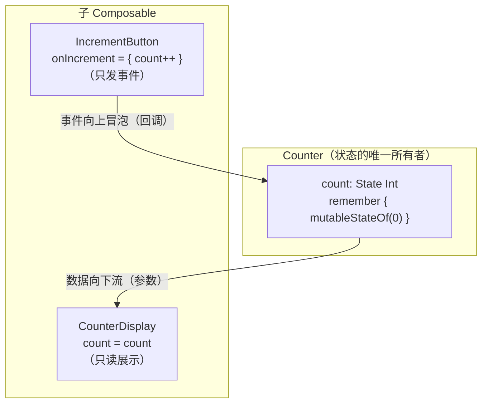

# Jetpack Compose 心智模型与 API 设计思路

> 本文基于 Leland Richardson 的《Understanding Jetpack Compose — part 1 of 2》整理与扩展。它是姊妹篇中的"前篇"：讲清楚 **Compose 要解决什么问题、它的心智模型是什么、以及你应该如何设计 API**。而"后篇"（`jetpack-compose-internals-composer.md`）则深入编译器与运行时的实现原理。
>
> 建议先读本篇建立心智模型，再读后篇理解底层机制——两者互为表里。

## 写在前面

UI 开发的期望已经今非昔比。今天，如果没有一个精致的、带动画和动效的用户界面，我们几乎无法做出一个能满足用户需求的应用。而这些要求，在现有的 UI Toolkit 被创造出来的那个年代，是根本不存在的。

为了应对"快速、高效地打造精致 UI"这个技术挑战，我们引入了 Jetpack Compose——一个现代 UI 工具包，让开发者在新的时代里取得成功。

本篇解决三个问题：**Compose 应对了哪些挑战？它的心智模型是什么？你该如何塑造自己的 API？**

---

## 1. Compose 解决了什么挑战？

### 1.1 关注点分离：耦合与内聚

**关注点分离（Separation of Concerns）** 是一个众所周知的软件设计原则，但它是否真的被遵循了，往往很难判断。一个有用的思考框架，是把它落到两个具体的词上：**耦合（Coupling）** 和 **内聚（Cohesion）**。

- **耦合**：不同模块之间的依赖程度，反映一个模块的某部分如何影响另一个模块的某部分。
- **内聚**：模块内部单元之间的关系，反映模块内的单元被组织得有多好。

写可维护软件时，我们的目标是：**最小化耦合、最大化内聚**。

当模块高度耦合时，改一个地方就得改一堆其他地方。更糟的是，耦合往往是**隐式的**——一个看起来完全无关的改动，会让意想不到的地方崩溃。关注点分离的本质，就是**把尽可能多的相关代码放在一起**，让代码易于维护、能随应用增长而扩展。

### 1.2 今天的 Android 到底哪里耦合了？

我们用一个具体例子来看：一个 ViewModel 和一个 XML 布局。

```
ViewModel ──(数据)──▶ XML 布局
   ▲                    ▲
   └────── 隐式耦合 ────┘
```

ViewModel 给布局提供数据。但这里隐藏着**大量的依赖**：ViewModel 和布局之间存在大量耦合。最典型的表现，就是那些**要求你了解 XML 布局本身形状和内容**的 API，比如 `findViewById`。

```kotlin
// 这段代码"知道"布局里有一个 id 叫 R.id.title 的 TextView
findViewById<TextView>(R.id.title).text = "Hello"
```

使用这类 API，**必须知道 XML 布局是如何定义的**，这就在两者之间制造了耦合。随着应用增长，我们必须时刻确保这些依赖不会过时。

而且，大多数现代应用会**动态地**显示 UI，并在执行过程中不断演化。因此，我们不仅要静态地验证这些依赖被布局 XML 满足，还要验证它们在**程序的整个生命周期**里都被满足。如果一个元素在运行时离开了视图层级，某些依赖就会断裂，进而导致 `NullPointerException` 这类问题。

### 1.3 根本问题：两种语言之间被强行划了一道线

通常，ViewModel 用 Kotlin 这样的编程语言定义，而布局用 XML 定义。**因为语言不同，两者之间被强行划了一道分离线**——即使 ViewModel 和布局 XML 有时关系极其紧密。换句话说，它们**被紧紧地耦合在了一起**。

这引出了一个自然的问题：

> **如果我们开始用同一种语言来定义布局、定义 UI 的结构呢？如果我们选择 Kotlin 呢？**

当我们用同一种语言工作时，之前那些**隐式的依赖**就开始变得**显式**了。我们也能重构代码、把东西挪到能降低耦合、提高内聚的地方去。

### 1.4 澄清一个误区：这不是"把逻辑混进 UI"

你可能会想：这是不是建议你把逻辑和 UI 混在一起？

现实是：**无论你的应用怎么组织，你都会有 UI 相关的逻辑存在。** 框架本身无法改变这一点。

但框架能做的，是**给你提供工具让分离变得更容易**——这个工具就是 **Composable 函数**。函数，是你长期以来在代码别处用来分离关注点的工具。你为"重构、写可靠、可维护、干净代码"所积累的那些技能，**同样适用于 Composable 函数**。

> Compose 不消除 UI 逻辑，它只是让你用"函数"这个最趁手的工具去管理它。

---

## 2. Composable 函数的结构

这是一个 Composable 函数的例子：

```kotlin
@Composable
fun App(appData: AppData) {
    Header(appData.header)
    Body(appData.body)
}
```

它从 `AppData` 数据类接收数据作为参数。**理想情况下，这个数据是不可变的（immutable）**，Composable 函数不去改变它——**Composable 函数应该是这个数据的"变换函数"（transform function）**。

因此，我们可以用任何 Kotlin 代码，把这个数据拿过来，用来描述我们的层级结构，比如上面的 `Header()` 和 `Body()` 调用。

这意味着：

1. **调用其他 Composable 函数，这些调用就代表了 UI 的层级结构。**
2. **我们可以使用 Kotlin 提供的所有语言级原语来做动态的事情**——`if` 语句、`for` 循环等控制流，用来处理更复杂的 UI 逻辑。

```kotlin
@Composable
fun App(items: List<Item>) {
    if (items.isEmpty()) {
        EmptyState()
    } else {
        for (item in items) {
            ItemRow(item)
        }
    }
}
```

Composable 函数还经常利用 Kotlin 的 **尾随 lambda 语法**。比如 `Body()` 是一个接收 Composable lambda 作为参数的 Composable 函数，这暗示了一种**层级或结构**——`Body()` 包裹了它内部的一组元素：

```kotlin
@Composable
fun App() {
    Body {
        Text("第一项")
        Text("第二项")
    }
}
```

---

## 3. 声明式 UI

"声明式（Declarative）"是个流行词，但它很重要。我们谈论声明式编程时，是**相对于命令式（Imperative）编程**而言的。

看一个例子：一个邮箱应用有一个"未读消息"图标。

- 没有消息时 → 渲染一个空信封；
- 有一些消息时 → 信封里渲染一些纸张；
- 有 100 条消息时 → 把图标渲染成"着火"的样子。

### 3.1 命令式写法

用命令式接口，我们可能得写这样一个 `updateCount` 函数：

```kotlin
fun updateCount(count: Int) {
    if (count > 0 && !hasBadge()) {
        addBadge()                       // 加上小红点
    } else if (count == 0 && hasBadge()) {
        removeBadge()                    // 去掉小红点
    }
    if (count > 99 && !hasFire()) {
        addFire()                        // 点燃火焰
        setBadgeText("99+")
    } else if (count <= 99 && hasFire()) {
        removeFire()                     // 熄灭火焰
        setBadgeText(if (count == 0) "" else "$count")
    }
}
```

我们接收新的 count，然后必须**自己搞清楚如何把当前 UI 更新到那个状态**。这里有大量边界情况，即便这只是个相对简单的例子，这个逻辑也一点都不轻松。更糟的是：你**必须时刻记住 UI 之前处于什么状态**。

### 3.2 声明式写法

用声明式接口写同样的逻辑，可能长这样：

```kotlin
@Composable
fun Badge(count: Int) {
    if (count > 0) {
        if (count > 99) {
            FireBadge(text = "99+")
        } else {
            PaperBadge(text = "$count")
        }
    } else {
        EmptyEnvelope()
    }
}
```

这里我们说的是：

> "这就是我想要的 UI 应该是什么样子"——**而不是**"如何一步步过渡到那个状态"。

这就是声明式 API 的含义：**代码描述的是我们想要的 UI，而不是如何转变到这个状态。**

关键点在于：写声明式代码时，**你不再需要关心 UI 之前处于什么状态**，你只需要指定**当前状态应该是什么**。至于如何从一个状态到另一个状态，**由框架来控制**，我们不再需要思考它。

---

## 4. 组合 vs 继承

在软件开发中，**组合（Composition）** 是"多个简单代码单元如何组合成一个更复杂的代码单元"。在面向对象模型里，组合最常见的形式是**基于类的继承**。而在 Jetpack Compose 的世界里，因为我们只用函数、不用类，组合的方式截然不同，却比继承有更多优势。

### 4.1 继承的困境：日期范围输入

假设我们有一个 `View`，想给它加输入。在继承模型里，代码可能长这样：

```
View
 └── Input
      └── ValidatedInput
           └── DateInput
```

- `View` 是基类。
- `ValidatedInput` 继承 `Input`。
- 为了校验日期，`DateInput` 继承 `ValidatedInput`。

但这时挑战来了：我们想做一个**日期范围输入**，它需要校验**两个**日期——开始日期和结束日期。你可以继承 `DateInput`，但你需要**继承两次**——而你做不到。**这就是继承的局限：我们必须只能有一个单一父类。**

### 4.2 Compose 的解法：两次调用而已

在 Compose 里，这不是问题。假设我们从一个基础 `Input` Composable 开始：

```kotlin
@Composable
fun Input(...) { /* ... */ }

@Composable
fun ValidatedInput(...) {
    Input(...)
    // 再装饰一些校验逻辑
}

@Composable
fun DateInput(...) {
    ValidatedInput(...)
}

// 日期范围输入？不再是难题——只是两次调用而已
@Composable
fun DateRangeInput(...) {
    ValidatedInput(/* 开始日期 */)
    ValidatedInput(/* 结束日期 */)
}
```

在 Compose 的组合模型里，**没有单一的父类可以"组合到其上"**，这就解决了继承模型的难题。

### 4.3 装饰器困境：FancyBox

另一类组合问题是**对一种"装饰"进行抽象**。看下面这个继承例子：

```
FancyBox 是一个装饰其他视图的视图：
- Story
- EditForm

我们想要 FancyStory 和 FancyEditForm，但怎么实现？
是继承 FancyBox，还是继承 Story？不清楚——因为继承链只需要一个父类。
```

Compose 则处理得非常好。我们有 **Composable lambda 作为 children**，让我们能定义"一个包裹另一个东西"的东西：

```kotlin
@Composable
fun FancyBox(children: @Composable () -> Unit) {
    Box(modifier = Modifier.border(...)) {
        children()
    }
}

@Composable
fun FancyStory() {
    FancyBox {
        Story()
    }
}

@Composable
fun FancyEditForm() {
    FancyBox {
        EditForm()
    }
}
```

当我们想创建 `FancyStory` 时，就在 `FancyBox` 的 children 里调用 `Story`；`FancyEditForm` 同理。**这就是 Compose 的组合模型。**

---

## 5. 封装

Compose 做得好的另一件事是**封装（Encapsulation）**。这是你在设计 Composable 函数的公开 API 时应该思考的：

> **一个 Composable 的公开 API，就是它接收的那一组参数——它对它们没有控制权（由调用方传入）。**

另一方面，一个 Composable 可以**自己管理并创建状态**，然后把这个状态连同它接收到的数据，一起作为参数传给其他 Composable。

而因为它管理着状态，如果你想要改变状态，可以让子 Composable **通过回调（callback）把"改变"的信号传回来**：

```kotlin
@Composable
fun Counter() {
    // 自己管理并创建状态
    var count by remember { mutableStateOf(0) }

    // 把状态传给子 Composable，并让子组件通过回调改变它
    CounterDisplay(count = count)
    IncrementButton(onIncrement = { count++ })
}
```

这就是 Compose 中"单向数据流"的雏形：**数据向下流动（作为参数），事件向上冒泡（作为回调）。**

用一张图看得更清楚——状态只有一个所有者，数据沿"下"流动、事件沿"上"回流：



> 这个模式的意义在于**单一数据源（single source of truth）**：`count` 只被 `Counter` 一个人拥有和修改，子组件要么只读它（参数），要么请求改变它（回调），谁也不能绕过所有者直接改。这既保证了状态可预测，也是 §6 要讲的 `remember` 之所以能"跨重组存活"的前提——状态有明确的"家"。

---

## 6. 状态与 remember

在 §5 封装里，我们第一次见到了 `remember { mutableStateOf(0) }`。这一节专门讲清楚 `remember` 到底是什么、它的心智模型，以及它的各种用法。

> 本节只讲"**怎么想、怎么用**"。至于 `remember` 编译后变成了什么、运行时如何工作，属于实现原理，留给后篇（`jetpack-compose-internals-composer.md` §4.4）。

### 6.1 一个致命问题：没有 remember 会怎样？

先想一个问题：Composable 函数是"可以随时被重新调用"的（这正是"重组"）。那么，如果我们在函数体里直接写一个局部变量，重组之后它还在吗？

```kotlin
@Composable
fun Counter() {
    var count = 0            // ❌ 每次重组都会被重置为 0！
    Button(onClick = { count++ }) {
        Text("Count: $count")
    }
}
```

这段代码的问题在于：`count` 是一个**普通的局部变量**。每次 `Counter` 被重组（重新调用）时，`var count = 0` 这行都会**重新执行**，`count` 又被重置回 0。你点击按钮 `count++`，触发了重组，然后 `count` 又被重置为 0——**计数永远加不上去**。

这就是 `remember` 存在的理由：

> **`remember` 让一个值"活过"重组——在函数被重新调用时，把上一次的值"记住"。**

```kotlin
@Composable
fun Counter() {
    var count by remember { mutableStateOf(0) }   // ✅ 跨重组存活
    Button(onClick = { count++ }) {
        Text("Count: $count")
    }
}
```

### 6.2 心智模型：Composable 是无记忆的纯函数，remember 给它注入记忆

这里有一个非常关键的心智模型：

> **Composable 函数本身是"无记忆"的——它只是"数据 → UI"的变换函数。而 `remember` 是在这个无记忆的函数里，人为地"注入"一段跨调用存活的记忆。**

可以把 Composable 想象成一个"每次都被擦干净重画的画板"。`remember` 的作用，就是在这个画板上**钉一枚图钉**，让某个东西"被擦掉重画之后，还能留在原地"。

这枚图钉钉在**哪里**（你在源码的哪个位置调用 remember），决定了它记住的东西归谁所有、活多久。这个"位置"一旦改变，记忆就会丢失——这就是后篇要讲的"位置记忆化"的由来。

### 6.3 remember 与 mutableStateOf 的分工

`remember { mutableStateOf(0) }` 里其实藏着**两个**东西，职责完全不同，分开理解很重要：

| 组件 | 职责 | 单独用会怎样 |
|---|---|---|
| `mutableStateOf(0)` | 创建一个**可变的、可观察的**状态对象：读它会被"订阅"，写它（改值）会通知订阅者（触发重组） | 单独用：每次重组都创建一个新的 state 对象，值会丢 |
| `remember { }` | 让 lambda 里的对象**跨重组存活**（只在第一次创建，之后复用同一个对象） | 单独用：记住的对象若是普通 `Int`，改不了、也不会触发重组 |

所以：

- `remember` 负责"**记住对象**"——别每次重组都重新 new 一个；
- `mutableStateOf` 负责"**可变 + 通知重组**"。

两者配合，才构成一个"跨重组存活、且改了会触发重组"的变量。

这也解释了为什么写 `var count by remember { mutableStateOf(0) }`，而不是 `var count by mutableStateOf(0)`——后者每次重组都会丢状态（§6.1 已经演示了这个坑）。

### 6.4 带 key 的 remember：何时重新计算

`remember` 可以带一组 key（输入参数）：

```kotlin
@Composable
fun App(items: List<String>, query: String) {
    // 只有当 items 或 query 变化时，才重新执行 filter
    val results = remember(items, query) {
        items.filter { it.matches(query) }
    }
    LazyColumn {
        items(results) { Text(it) }
    }
}
```

心智模型：`remember` 记住的是"**上一次的 key + 上一次的结果**"。每次重组时，它拿**新的 key 和旧的 key 比较**：

- key 都没变 → 返回**旧结果**（跳过计算）；
- 任何一个 key 变了 → 重新执行计算，并**用新的 key 和结果覆盖旧的**。

> 注意：比较 key 用的是 `equals`（结构性相等），不是引用相等。对 `List`、`String` 这类值类型通常符合直觉；但对自定义对象，要确保 `equals` 的实现符合你的意图。

### 6.5 常用用法模式

#### ① 记住可变状态（最常见）

```kotlin
var text by remember { mutableStateOf("") }
var enabled by remember { mutableStateOf(true) }
```

#### ② 记住一次性的昂贵初始化（零 key）

```kotlin
val formatter = remember { DateTimeFormatter.ofPattern("yyyy-MM-dd") }
// 只在第一次组合时创建，之后复用同一个实例
```

#### ③ 记住派生计算（带 key）

```kotlin
val visibleItems = remember(items, filter) { items.filter(filter) }
```

#### ④ 派生状态 derivedStateOf（延迟计算、只在读取时算）

```kotlin
val isScrolled by remember { derivedStateOf { scrollState.value > 0 } }
// derivedStateOf 会"记住"它读取的 state，只在真正需要时重新计算
```

#### ⑤ rememberSaveable：跨配置变更 / 进程重建

普通的 `remember` 在**配置变更**（如旋转屏幕导致 Activity 重建）或**进程被杀**时**不会**存活。如果你希望值在这类场景下也保留（比如一个输入框的文字），用 `rememberSaveable`：

```kotlin
var name by rememberSaveable { mutableStateOf("") }
// 旋转屏幕后，name 仍然是用户输入的值
```

`rememberSaveable` 会把值放进 `Bundle`（通过 `Saver` 机制），能在 Activity 重建时恢复。它支持 `Bundle` 能序列化的类型（基本类型、`String`、`Parcelable` 等），复杂类型需要自定义 `Saver`。

#### ⑥ rememberUpdatedState：在长生命周期副作用里捕获最新值

这是六个用法里**最容易踩坑、也最需要单独展开**的一个，下面多花点篇幅讲透。

**第一步：先理解"副作用"的关键特性**

在 Compose 里，`LaunchedEffect`、`DisposableEffect`、`rememberCoroutineScope` 里启动的协程、`Animatable` / 动画循环等，都叫**副作用（Side Effect）**。它们有一个共同的关键特性：

> **副作用是"跨重组存活"的代码块** —— 它启动一次之后，会一直运行下去（直到它的 key 变化、或它离开组合），**不会**因为外层 Composable 重组而重新启动。

这是理解 `rememberUpdatedState` 的前提。正因为副作用"只启动一次"，它内部写的代码**只会在启动那一刻执行一次**，而闭包里捕获的变量，也就"冻结"在了那一刻。

**第二步：问题的本质——闭包捕获了"过期值"**

看这段代码：

```kotlin
@Composable
fun LandingScreen(onTimeout: () -> Unit) {
    LaunchedEffect(Unit) {        // key = Unit → 只启动一次，永不重启
        delay(3000)               // 等待 3 秒
        onTimeout()               // ❌ 调用的是"第一次组合时"的那个 onTimeout
    }
}
```

这里有一个隐蔽的 bug：`LaunchedEffect` 的 lambda 里，`onTimeout` 是在**第一次组合时被捕获**的。之后如果父组件重组、传入了一个**新的** `onTimeout`（比如它捕获了新的 state、新的 navigation controller），这个副作用**不会重启**（因为 key 还是 `Unit`），但它闭包里的 `onTimeout` **还是旧的那个**。

结果就是：3 秒后它调用的是**过期的回调**——可能操作了已经被销毁或更新的对象，或者读到了过期数据。这种"闭包捕获了旧值"的问题，有个专门的叫法：**过期闭包 / 陈旧闭包（stale closure）**。

**第三步：为什么不能直接把 onTimeout 当 key？**

你可能会想：那把 `onTimeout` 放进 key 不就行了？

```kotlin
LaunchedEffect(onTimeout) { delay(3000); onTimeout() }
```

但这样做的代价是：**每次 `onTimeout` 变化，副作用就会被重启** —— 旧的协程被取消，新的协程启动，`delay(3000)` **重新开始计时**。而回调 lambda 往往**每次重组都会被重新创建**（父组件里内联的 lambda 每次都是新实例），于是这个倒计时会被反复重置，**可能永远走不完**。

这通常不是我们想要的。我们想要的是：**倒计时继续走，但回调用最新的。**

**第四步：rememberUpdatedState 的解法——把"值"换成"引用"**

```kotlin
@Composable
fun LandingScreen(onTimeout: () -> Unit) {
    val currentOnTimeout by rememberUpdatedState(onTimeout)

    LaunchedEffect(Unit) {
        delay(3000)
        currentOnTimeout()   // ✅ 总是调用"最新"的回调
    }
}
```

关键点在于，它把"**值**"换成了"**指向值的引用**"：

- **不用它时**：闭包捕获的是 `onTimeout` 这个**值**（一个 lambda 实例），这个值是**冻结的**；
- **用它时**：闭包捕获的是 `currentOnTimeout` 这个 **State 对象的引用**（这个引用**永远不变**），但每次重组时，`rememberUpdatedState` 都会把这个 State 的 `.value` 更新为最新的 `onTimeout`。

所以副作用里读 `currentOnTimeout`，永远是读到最新的回调；而因为 `LaunchedEffect` 的 key 还是 `Unit`，副作用**不会重启**。两者兼得。

> **一句话心智模型：`rememberUpdatedState` 是一个"每次重组都更新、但更新本身不触发重组"的 `State`。** 它让你"记住最新值"的同时，不把"值变化"变成"重启副作用"的理由。
>
> （类比：它很像 React 里 `useRef` + `useEffect` 的组合——用一个不引发重渲染的可变引用来存最新值。）

**三种写法对比**

| 写法 | 行为 | 问题 |
|---|---|---|
| `LaunchedEffect(Unit) { ... onTimeout() }`（直接捕获） | 只启动一次，回调冻结在启动时 | 3 秒后可能调用过期的回调（stale closure） |
| `LaunchedEffect(onTimeout) { ... }`（把值当 key） | 值一变就重启副作用 | 倒计时被反复重置，可能永远跑不完 |
| `rememberUpdatedState` + `LaunchedEffect(Unit)` | 只启动一次，回调始终最新 | ✅ 无 |

**什么时候用、什么时候不用**

- **用**：副作用是"长生命周期"的（倒计时、轮询、动画循环、注册监听、`DisposableEffect` 的清理逻辑），它需要读取一个"会随时间变化"的值（通常是回调 lambda，或某个会变的外部状态），而你**不想因为该值变化而重启副作用**。
- **不用**：如果值变化时你**确实希望副作用重启**（比如 key 变了就该重新请求数据），那就直接把值放进 key 即可，不需要 `rememberUpdatedState`。

**一个现实中的高频场景**：回调 lambda 作为 Composable 参数。因为 lambda 常常每次重组都重新创建，副作用直接捕获它几乎一定会捕获到旧实例。因此，凡是在 `LaunchedEffect` / `DisposableEffect` 里调用"作为参数传入的回调"，都应该考虑用 `rememberUpdatedState` 包一层。

**一个记忆口诀**

> **副作用要"活得久"，回调要"用最新的"——用 `rememberUpdatedState` 把"值"换成"引用"。**

### 6.6 remember 的生命周期：何时被"遗忘"

`remember` 记住的值，**不是永久的**。它的生命周期绑定在**它在组合树中的位置**上：

- 当这个 Composable **离开组合**（比如某个 `if` 分支不再成立、某个列表项被移除），它记住的值就会被**遗忘（forget）**；
- 当它**重新进入组合**，会**从头开始**（重新执行 `remember` 的 lambda，得到全新的值）。

```kotlin
@Composable
fun App(showCounter: Boolean) {
    if (showCounter) {
        Counter()   // showCounter 变 false 时，Counter 里 remember 的值被丢弃
    }
}
```

这是 `remember` 和"全局缓存"最本质的区别：**它记住的东西，会跟着它的"位置"一起生灭。** 所以千万别把 `remember` 当成一个"全局的、跨一切存活的缓存"来用。

### 6.7 常见误区

1. **以为 remember 是全局缓存** —— 它是"位置绑定"的，离开组合就没了。
2. **该带 key 的没带** —— 导致结果不更新（用了过期数据）。
3. **key 里放了不稳定对象** —— key 用 `equals` 比较，对象 `equals` 不稳定会导致"以为变了其实没变"或反之。
4. **该用 rememberSaveable 却用了 remember** —— 旋转屏幕后输入丢失。
5. **用 remember 存"不该跨重组存活"的东西** —— 比如记住一个捕获了会随参数变化的值的 lambda，应该用 `rememberUpdatedState` 或直接不 remember。

---

## 7. 副作用（Side Effect）

在 §6.5 ⑥ 讲 `rememberUpdatedState` 时，我们反复用到两个概念——**副作用**和**重启**，但当时只是一笔带过。这一节把它们系统讲清楚。

### 7.1 什么是副作用？

在函数式编程里，**副作用（Side Effect）** 指的是：函数除了"返回一个值"之外，还对函数外部世界产生的**任何可观察的影响**。例如：

- 修改一个外部变量；
- 发起网络请求、读写数据库、读写文件；
- 读取系统状态（如 `System.currentTimeMillis()`）；
- 打日志、弹 Toast、更新某个非 Compose 的 UI。

相对地，一个 **纯函数（pure function）** 就是：**给定相同输入，永远返回相同输出，且没有任何副作用。**

```kotlin
fun add(a: Int, b: Int) = a + b                    // 纯函数：无副作用
fun logAdd(a: Int, b: Int) = println(a + b)        // 有副作用：打印到控制台
```

### 7.2 为什么 Composable 要尽量"纯"？

回顾一下：Composable 函数会被**随时、多次地重新调用**（这就是"重组"，§8 会详讲）。这就带来一个致命问题：

> **如果 Composable 函数体里直接写了副作用，这些副作用会在每次重组时被重复执行——而重组可能发生很多次、可能被跳过、时机不可预测。**

举例：

```kotlin
@Composable
fun BadScreen(user: User) {
    Analytics.log("user viewed: ${user.name}")   // ❌ 副作用：打日志
    Text("Hello, ${user.name}")
}
```

`Analytics.log(...)` 是一个副作用。因为 `BadScreen` 会随着状态变化而多次重组，这行日志会被打印**很多次**——即使 UI 内容根本没变。更糟的是，重组的时机由框架决定，日志的时机完全不可预测。

所以 Compose 的心智模型里有一条铁律：

> **Composable 函数应该是"纯的"——它只做一件事：把输入数据"变换"成 UI 描述。任何副作用，都必须放进 Compose 提供的"受控副作用 API"里。**

### 7.3 受控的副作用 API：把副作用"框"进生命周期

Compose 不是不让你写副作用，而是让你把它**放进受控的容器**里。这些容器的共同特点是：它们把副作用绑定在**组合的生命周期**上（进入组合时启动、离开组合时清理、key 变化时重启）。

| API | 何时执行副作用 | 典型用途 |
|---|---|---|
| `SideEffect` | 每次成功重组之后 | 把 Compose 状态同步给非 Compose 代码（如通知外部库） |
| `LaunchedEffect(key)` | 进入组合启动协程；key 变 → 重启；离开 → 取消 | 一次性/带 key 的异步操作、倒计时、轮询 |
| `DisposableEffect(key)` | 进入组合执行；key 变 → 先清理再执行；离开 → 清理 | 注册/注销监听器、释放资源 |
| `rememberCoroutineScope()` | 给你一个绑定组合生命周期的协程作用域，随时手动启动 | 在点击等事件里启动异步任务 |
| `produceState(...)` | 启动协程，持续产出状态值 | 把一个非 Compose 数据源转成 State |

其中 `LaunchedEffect` 和 `DisposableEffect` 是最典型的两个，也是 `rememberUpdatedState` 最常见的用武之地。

### 7.4 effect 的"重启"：key 变化时发生了什么？

现在专门解释"重启"这个动作（`rememberUpdatedState` 一节里反复提到的"不重启副作用"）。

以 `LaunchedEffect` 为例，它的生命周期**由 key 驱动**：

```kotlin
LaunchedEffect(key1, key2, ...) {
    // 副作用体（一段协程代码）
}
```

规则如下：

1. **第一次进入组合**：启动协程，执行副作用体；
2. **key 变化**：**先取消**旧协程，**再启动**新协程，从头执行副作用体——这就是"**重启**"；
3. **离开组合**：取消协程（副作用结束）。

"重启"之所以要**先取消旧的**，是为了避免"旧协程和新协程同时运行"导致的问题（比如两个协程同时更新同一个状态、重复发请求）。

用一段代码感受"重启"的影响：

```kotlin
@Composable
fun Countdown(seconds: Int) {
    var remaining by remember { mutableStateOf(seconds) }

    LaunchedEffect(seconds) {          // key = seconds
        repeat(seconds) {
            delay(1000)
            remaining--
        }
    }
}
```

当 `seconds` 从 3 变成 5 时，旧的倒计时协程被**取消**，新的协程从 5 开始重新倒数——这就是"重启"。这通常**正是我们想要的**（重新倒计时）。

但回到 `rememberUpdatedState` 的场景：

```kotlin
LaunchedEffect(Unit) { ... }   // key = Unit，永不重启
```

如果我们想要的是"**副作用只启动一次、但内部读取的值始终最新**"，就不能把会变的值（如回调）放进 key（否则一变就重启），而要用 `rememberUpdatedState` 让副作用"读到最新值而不重启"——这正是 §6.5 ⑥ 的核心。

> 小结两组容易混淆的词：
> - **重组（Recomposition）**：Composable **函数**被重新调用、重画 UI。
> - **重启（Restart）**：**副作用**（effect 的协程）被取消后重新启动。
>
> 两者是不同层面的概念：一个 Composable 重组时，它内部的 `LaunchedEffect(Unit)` **不会**重启；而 `LaunchedEffect(someKey)` 会因 key 变化而重启。

### 7.5 为什么这解释了 rememberUpdatedState 的存在

现在回看 §6.5 ⑥ 的 `rememberUpdatedState`，它的存在理由就是**这两节概念的组合**：

- 副作用（`LaunchedEffect`）是"跨重组存活、由 key 控制重启"的；
- 而回调 lambda 是"每次重组都可能变"的值；
- 把回调放进 key → 副作用被反复重启（不想要）；
- 直接捕获回调 → 捕获到过期值（也不想要）；
- 于是需要 `rememberUpdatedState`：让副作用"读到最新值"、却"不因它重启"。

所以：**`rememberUpdatedState` 是"副作用 + 重启"这两个概念交汇处的解决方案。** 理解了副作用和重启，`rememberUpdatedState` 自然就懂了。

---

## 8. 重组（Recomposition）

"重组"是我们对"**任何 Composable 函数都可以在任何时候被重新调用**"这件事的说法。

当你有一个非常庞大的 Composable 层级时，如果层级的一部分变了，你**不希望重新计算整个层级**。所以 Composable 函数是**可重启的（restartable）**，你可以用它来做一些强大而高效的事。

看一个今天 Android 开发里常见的 `Bind` 函数：

```kotlin
// 传统的命令式写法
fun bind(liveData: LiveData<Message>, lifecycleOwner: LifecycleOwner) {
    liveData.observe(lifecycleOwner) { message ->
        textView.text = message.text
    }
}
```

我们有一个 `LiveData`，想把视图订阅上去。做法是：用生命周期所有者调用 `observe` 方法，然后传一个 lambda。每次 `LiveData` 更新时 lambda 被调用，我们去更新视图。

**Compose 则把这个关系"反转"了过来：**

```kotlin
@Composable
fun Messages(liveData: LiveData<Message>) {
    val message by liveData.observeAsState()

    // 直接使用 message.value，无需 observe、无需 lifecycleOwner、无需回调
    Text(message.text)
}
```

有一个类似的 `Messages` Composable，它接收 `LiveData`，并调用 Compose 的 `observeAsState()` 方法：

- `observeAsState()` 把 `LiveData<T>` 映射成 `State<T>`，于是你可以在函数体内直接使用这个值。
- 这个 `State` 实例订阅了 `LiveData`，意味着 `LiveData` 更新时它也会更新。
- 这也意味着：**无论 `State` 实例在哪里被读取，读取它的那个外层 Composable 函数都会被自动订阅到这些变化。**

最终的结果是：**不再需要指定 `LifecycleOwner` 或更新回调了**，因为 Composable 隐式地同时扮演了这两者的角色。

这就是 Compose 心智模型里最优雅的一环：**你只要描述"数据 + 状态"，订阅、生命周期、更新这些脏活累活，全部交给框架。**

---

## 9. 总结

Compose 提供了一种现代的 UI 定义方式，让你能**有效地分离关注点**：

1. **它解决的挑战**：用同一种语言（Kotlin）定义 UI，消除 ViewModel 与 XML 之间那条被强行划出的、导致隐式耦合的线。
2. **它的心智模型**：
   - Composable 函数是"数据的变换函数"，用函数而非类来组合 UI；
   - 声明式：只描述"当前状态应该是什么"，不描述"如何过渡"；
   - 组合优先于继承：用函数调用和 lambda children 解决继承的困境；
   - 封装：公开 API = 参数，状态向下流、事件向上冒泡；
   - 状态与 remember：Composable 本身无记忆，`remember` 让值跨重组存活，`mutableStateOf` 让值可变并触发重组；
   - 副作用：Composable 要"纯"，副作用放进受控 API（`LaunchedEffect` 等），由 key 控制重启；
   - 重组：任何 Composable 可随时被重调，但框架只重算"变了的"那部分。
3. **它的 API 设计原则**：把 Composable 想成普通函数，把"写干净、可维护代码"的老技能原样搬过来即可。

**最后**：因为 Composable 函数与普通 Kotlin 函数如此相似，你用来编写和重构它们的工具，会无缝地融入你既有的 Android 开发技能包里。

下一篇（`jetpack-compose-internals-composer.md`）将把焦点转移到 Compose 及其编译器的**实现细节**上：以 `@Composable` 注解编译后的行为为主线，深入 Composer、Slot Table、Gap Buffer、位置记忆化与重组机制。

---

## 参考

- Leland Richardson, *Understanding Jetpack Compose — part 1 of 2*, Android Developers on Medium, 2020.
- Leland Richardson, *Under the hood of Jetpack Compose — part 2 of 2*, Android Developers on Medium, 2020-08-28.
- [Jetpack Compose 官方文档](https://developer.android.com/jetpack/compose)
